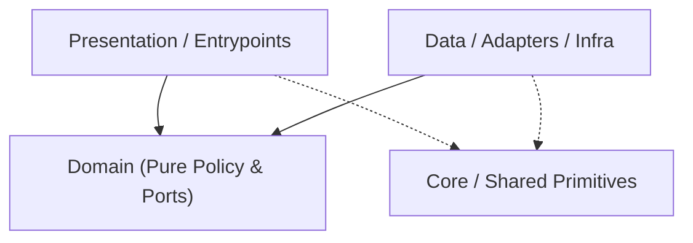

# Codebase Architecture Map — `agent-remote`

> Auto-generated by `project-pro map` (2026-10-31 11:54 UTC). Read this first to save exploration tokens.
- **Detected Stack**: `kmp` | **Mode**: `configured`

## 1. Canonical Layer Dependency Flow

## 2. Layer Distribution (Code Files)
- **Domain**: `14` | **Data/Infra**: `15` | **Presentation/UI**: `21` | **Core/Shared**: `0` | **Tests**: `5` | **Other**: `6`

## 3. Module / Directory Index (Top Slices)
- `app/` — `2` files (`125` LOC)
- `app/src/androidMain/` — `4` files (`57` LOC)
- `app/src/commonMain/` — `39` files (`2341` LOC)
- `app/src/commonTest/` — `5` files (`364` LOC)
- `app/src/desktopMain/` — `2` files (`11` LOC)
- `app/src/iosMain/` — `2` files (`14` LOC)
- `server/` — `3` files (`314` LOC)
- `server/adapters/` — `4` files (`286` LOC)

## 4. Key Contracts & Entry Interfaces
- `ConnectionStatus` (`app/src/commonMain/kotlin/core/domain/model/ConnectionStatus.kt`)
- `DomainGatewayEvent` (`app/src/commonMain/kotlin/core/domain/model/DomainGatewayEvent.kt`)
- `AgentGatewayClient` (`app/src/commonMain/kotlin/core/domain/repository/AgentGatewayClient.kt`)
- `AppResult` (`app/src/commonMain/kotlin/core/domain/result/AppResult.kt`)
- `DomainError` (`app/src/commonMain/kotlin/core/domain/result/DomainError.kt`)
- `ChatEffect` (`app/src/commonMain/kotlin/features/chat/presentation/contract/ChatEffect.kt`)
- `ChatIntent` (`app/src/commonMain/kotlin/features/chat/presentation/contract/ChatIntent.kt`)
- `SettingsIntent` (`app/src/commonMain/kotlin/features/settings/presentation/contract/SettingsIntent.kt`)
- `UpdateStatus` (`app/src/commonMain/kotlin/features/updater/domain/model/UpdateStatus.kt`)
- `AppUpdateRepository` (`app/src/commonMain/kotlin/features/updater/domain/repository/AppUpdateRepository.kt`)
