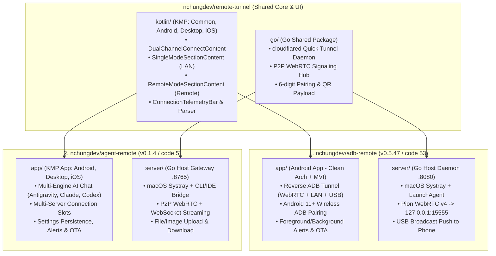

# Engineering Handoff: `adb-remote` & `agent-remote` (+ `remote-tunnel`)

> **Updated**: `2026-11-02T18:39:06+07:00`  
> **Workspace**: `/Volumes/512GB/AI Workspace`

---

## 1. Tổng Quan Hệ Sinh Thái (3 Repositories)

Hai dự án **`adb-remote`** và **`agent-remote`** cùng chia sẻ một thư viện lõi đa nền tảng **`remote-tunnel`** (được nhúng qua Git submodule tại `shared/remote-tunnel` và liên kết qua Gradle Composite Build + Go `replace` directive).



| Repository | Đường dẫn Local | GitHub Remote | HEAD Commit | Phiên bản Release mới nhất |
| :--- | :--- | :--- | :--- | :--- |
| **`adb-remote`** | [`/Volumes/512GB/AI Workspace/adb-remote`](file:///Volumes/512GB/AI%20Workspace/adb-remote) | `nchungdev/adb-remote` | `20e763e` | `v0.5.47` (`versionCode=53`) |
| **`agent-remote`** | [`/Volumes/512GB/AI Workspace/agent-remote`](file:///Volumes/512GB/AI%20Workspace/agent-remote) | `nchungdev/agent-remote` | `ddf6593` | `v0.1.4` (`versionCode=5`) |
| **`remote-tunnel`** | [`/Volumes/512GB/AI Workspace/remote-tunnel`](file:///Volumes/512GB/AI%20Workspace/remote-tunnel) | `nchungdev/remote-tunnel` | `2b26d7b` | Submodule đồng bộ ở cả 2 app |

---

## 2. Handoff Chi Tiết — Project 1: `adb-remote`

### 2.1. Kiến trúc & Cấu trúc Thư mục
- **Monorepo Layout**:
  - [`app/`](file:///Volumes/512GB/AI%20Workspace/adb-remote/app): Dự án Android độc lập (`package app.duinch.adbagent`), tuân thủ nghiêm ngặt **Clean Architecture + Feature-First + MVI (`UiState`, `UiIntent`, `UiEffect`)** và giới hạn **tất cả các file code `<= 300 LOC`**.
  - [`server/`](file:///Volumes/512GB/AI%20Workspace/adb-remote/server): Go Host Daemon (`ADB Device Manager`, port `8080`), tích hợp Pion WebRTC v4 (`DataChannel "adb-stream"` bridge thẳng vào `127.0.0.1:15555`), Cloudflare Quick Tunnel on-demand, và macOS Menu Bar Systray.
  - [`shared/remote-tunnel/`](file:///Volumes/512GB/AI%20Workspace/adb-remote/shared/remote-tunnel): Git submodule trỏ tới `nchungdev/remote-tunnel`.

### 2.2. Các Tính Năng & Luồng Đã Hoàn Thiện
1. **Single-Mode Multi-Server Connection Cards & Empty View**:
   - [`TunnelHomeTab.kt`](file:///Volumes/512GB/AI%20Workspace/adb-remote/app/src/main/kotlin/app/duinch/adbagent/features/tunnel/presentation/TunnelHomeTab.kt): Khi chưa cắm cáp USB và chưa thêm server nào, hiển thị [`EmptyConnectionCard.kt`](file:///Volumes/512GB/AI%20Workspace/adb-remote/app/src/main/kotlin/app/duinch/adbagent/features/tunnel/presentation/EmptyConnectionCard.kt) (*"Chưa Có Kết Nối Nào"*).
   - Khi cắm cáp USB, tự động hiển thị thẻ phần cứng `UsbConnectionCard` ([`AdbDeviceStatusCard.kt`](file:///Volumes/512GB/AI%20Workspace/adb-remote/app/src/main/kotlin/app/duinch/adbagent/features/tunnel/presentation/AdbDeviceStatusCard.kt)) kèm tên máy tính thật (`usbHostName`) và telemetry thời gian thực.
   - Bấm `[+ Thêm máy chủ kết nối]` mở [`AddConnectionModeDialog.kt`](file:///Volumes/512GB/AI%20Workspace/adb-remote/app/src/main/kotlin/app/duinch/adbagent/features/tunnel/presentation/AddConnectionModeDialog.kt) với 3 lựa chọn liền mạch:
     1. **`Quét Mã QR Nhanh`**: Mở thẳng camera quét mã QR trên màn hình máy tính.
     2. **`Cùng Mạng Wi-Fi (LAN)`**: Tạo thẻ Wi-Fi, tự động kích hoạt quét mDNS và mở sẵn ô nhập IP để bấm `[⚡ Kết Nối]` ngay trong 1 bước.
     3. **`Mạng Từ Xa (Remote URL)`**: Tạo thẻ Từ Xa, mở sẵn ô nhập URL Cloudflare / mã phòng P2P và danh sách `RecentTunnelsSection`.
2. **Trạng Thái Kết Nối Tự Nhiên & Thông Báo Đa Môi Trường**:
   - Toàn bộ badge hiển thị chuẩn tiếng Việt tự nhiên: `CHƯA KẾT NỐI`, `ĐANG KẾT NỐI...`, `ĐANG KẾT NỐI LẠI`, `ĐÃ KẾT NỐI`.
   - Khi trạng thái thay đổi (kết nối/mất kết nối/cắm cáp USB), tự động hiện `Toast` nếu đang mở app hoặc đẩy System Notification (`adb_remote_connection_alerts`) nếu app đang chạy nền.
3. **Ghép Đôi Không Dây (Android 11+ Wireless Debugging)**:
   - Giao diện toàn màn hình [`WirelessPairingScreen.kt`](file:///Volumes/512GB/AI%20Workspace/adb-remote/app/src/main/kotlin/app/duinch/adbagent/features/pairing/presentation/WirelessPairingScreen.kt) kèm hướng dẫn trực quan 3 bước và tự động dò cổng mDNS.
4. **Cập Nhật OTA Chuẩn Hệ Thống**:
   - Tải APK từ GitHub Releases (`nchungdev/adb-remote`) với thanh tiến trình mượt (`animateFloatAsState`) và gọi `FileProvider` + `ACTION_VIEW` chuẩn Android.

### 2.3. Lệnh Build, Test & Release Chuẩn (`adb-remote`)
```bash
# 1. Kiểm tra kiến trúc, giới hạn <= 300 LOC & quét Secret/IP
python3 "/Volumes/512GB/AI Workspace/adb-remote/scripts/check_project.py"

# 2. Build APK & chạy Unit Test (Android + Go Server)
cd "/Volumes/512GB/AI Workspace/adb-remote/app" && ./gradlew assembleDebug testDebugUnitTest
cd "/Volumes/512GB/AI Workspace/adb-remote/server" && go test -race ./...

# 3. Đường dẫn file APK sau khi build
# /Volumes/512GB/AI Workspace/adb-remote/app/build/outputs/apk/debug/adb-remote-debug.apk
```

---

## 3. Handoff Chi Tiết — Project 2: `agent-remote`

### 3.1. Kiến trúc & Cấu trúc Thư mục
- **Monorepo Layout**:
  - [`app/`](file:///Volumes/512GB/AI%20Workspace/agent-remote/app): Ứng dụng Kotlin Multiplatform (`commonMain`, `androidMain`, `desktopMain`, `iosMain`), kiến trúc **Clean Architecture + MVI (`ChatViewModel`, `SettingsViewModel`)**, giới hạn file `<= 450 LOC` (khuyến nghị `<= 300 LOC`).
  - [`server/`](file:///Volumes/512GB/AI%20Workspace/agent-remote/server): Go Host Gateway (`Agent Remote Server`, port `8765`), điều phối các AI Coding Engine (`Antigravity`, `Claude Code`, `Codex`, `Mock`), hỗ trợ WebSocket + P2P WebRTC DataChannel, upload/download file đính kèm và macOS Menu Bar Systray.
  - [`shared/remote-tunnel/`](file:///Volumes/512GB/AI%20Workspace/agent-remote/shared/remote-tunnel): Git submodule trỏ tới `nchungdev/remote-tunnel`.

### 3.2. Các Tính Năng & Luồng Đã Hoàn Thiện
1. **Màn Hình Quản Lý Kết Nối (`ConnectScreen`) Đồng Bộ 100% Với `adb-remote`**:
   - [`ConnectTopBar.kt`](file:///Volumes/512GB/AI%20Workspace/agent-remote/app/src/commonMain/kotlin/features/connect/presentation/ConnectTopBar.kt): Luôn hiển thị thanh tiêu đề ở cả trạng thái Empty View với nút Quét QR nhanh và nút mở Cài đặt (`⚙️`).
   - [`ConnectScreen.kt`](file:///Volumes/512GB/AI%20Workspace/agent-remote/app/src/commonMain/kotlin/features/connect/presentation/ConnectScreen.kt) & [`AddConnectionModeDialog.kt`](file:///Volumes/512GB/AI%20Workspace/agent-remote/app/src/commonMain/kotlin/features/connect/presentation/AddConnectionModeDialog.kt): Hỗ trợ quản lý nhiều máy chủ (`Máy Chủ 1`, `Máy Chủ 2`...), chọn nhanh `Quét Mã QR Nhanh`, `Cùng Mạng Wi-Fi (LAN)`, hoặc `Mạng Từ Xa (Remote URL)` với ô nhập liệu mở sẵn liền mạch và lưu lịch sử `recentTunnels`.
2. **Màn Hình Cài Đặt & Cập Nhật (`SettingsScreen`) Thiết Kế Mới (`/ui-ux-pro-max`)**:
   - [`SettingsScreen.kt`](file:///Volumes/512GB/AI%20Workspace/agent-remote/app/src/commonMain/kotlin/features/settings/presentation/SettingsScreen.kt) & [`SettingsRowComponents.kt`](file:///Volumes/512GB/AI%20Workspace/agent-remote/app/src/commonMain/kotlin/features/settings/presentation/components/SettingsRowComponents.kt): Chia thành 4 nhóm rõ ràng:
     - `ĐƯỜNG TRUYỀN & MÁY CHỦ`: Dòng điều hướng sang Quản lý máy chủ kết nối (kèm badge `ĐÃ KẾT NỐI`) + công tắc `Tự động kết nối lại`.
     - `CODING ENGINE MẶC ĐỊNH`: Lưới Bento 2x2 (`EngineBentoGrid`) chọn nhanh `Antigravity`, `Claude Code`, `Codex`, `Mock` không bị cắt chữ.
     - `THÔNG BÁO & PHÊ DUYỆT`: Công tắc `Cảnh báo duyệt quyền thực thi` (khi Agent xin quyền sửa file/chạy lệnh) và `Thông báo trạng thái kết nối`.
     - `THÔNG TIN & CẬP NHẬT`: [`UpdateCard.kt`](file:///Volumes/512GB/AI%20Workspace/agent-remote/app/src/commonMain/kotlin/features/settings/presentation/components/UpdateCard.kt) đồng bộ tone màu tối `#1E1E22`, kiểm tra và cài đặt trực tiếp bản cập nhật OTA từ `nchungdev/agent-remote`.
3. **Lưu Trữ Bền Vững, Tự Động Kết Nối Lại, Thông Báo & Cài Đặt APK OTA**:
   - [`PlatformSettingsStorage.kt`](file:///Volumes/512GB/AI%20Workspace/agent-remote/app/src/commonMain/kotlin/features/settings/data/PlatformSettingsStorage.kt): Tự động lưu và khôi phục toàn bộ cấu hình qua `SharedPreferences` (Android) và `java.util.prefs.Preferences` (Desktop).
   - [`PlatformAlertNotifier.kt`](file:///Volumes/512GB/AI%20Workspace/agent-remote/app/src/commonMain/kotlin/core/presentation/util/PlatformAlertNotifier.kt): Phát `Toast` khi đang mở app hoặc đẩy System Notification (`agent_remote_connection_alerts`, `agent_remote_approval_alerts`) khi app ở nền.
   - [`PlatformApkInstaller.kt`](file:///Volumes/512GB/AI%20Workspace/agent-remote/app/src/commonMain/kotlin/features/settings/data/PlatformApkInstaller.kt): Tải luồng byte APK về `cacheDir/agent-remote-update.apk` và kích hoạt trình cài đặt hệ thống qua `FileProvider`.

### 3.3. Lệnh Build, Test & Release Chuẩn (`agent-remote`)
```bash
# 1. Kiểm tra kiến trúc, giới hạn <= 450 LOC & quét Secret/IP
python3 "/Volumes/512GB/AI Workspace/agent-remote/scripts/check_project.py"

# 2. Build APK & chạy Unit Test (KMP Android + Go Server)
cd "/Volumes/512GB/AI Workspace/agent-remote/app" && ./gradlew assembleDebug testDebugUnitTest
cd "/Volumes/512GB/AI Workspace/agent-remote/server" && go test -race ./...

# 3. Đường dẫn file APK sau khi build
# /Volumes/512GB/AI Workspace/agent-remote/app/build/outputs/apk/debug/agent-remote-app-debug.apk
```

---

## 4. Quy Trình Đồng Bộ Submodule & Bảo Mật (`project-pro` Gates)

> [!IMPORTANT]
> Cả 3 repository đều đã được gắn Git Hooks tự động tại `.githooks/pre-commit` và `.githooks/pre-push` (`git config core.hooksPath .githooks`) cùng công cụ kiểm tra của skill `project-pro`.

1. **Quy tắc Bảo mật (Zero Hardcoded Secrets / IPs / Identifiers)**:
   - Tuyệt đối **không** hardcode IP LAN cá nhân (`192.168.x.x` trong biến/default parameter, ngoại trừ chuỗi ví dụ placeholder UI có chữ `Ví dụ:` / `vd:`), mã phòng cố định (`xxx-xxx`), serial thiết bị cá nhân, hoặc API key/token.
2. **Quy trình khi sửa UI/Logic dùng chung trong `remote-tunnel`**:
   ```bash
   # Bước 1: Commit & push trên remote-tunnel trước
   cd "/Volumes/512GB/AI Workspace/remote-tunnel"
   python3 scripts/check_project.py
   git add -A && git commit -m "feat(ui): ..." && git push origin main

   # Bước 2: Kéo submodule mới nhất vào adb-remote và agent-remote
   cd "/Volumes/512GB/AI Workspace/adb-remote/shared/remote-tunnel" && git pull origin main
   cd "/Volumes/512GB/AI Workspace/agent-remote/shared/remote-tunnel" && git pull origin main
   ```
3. **Danh sách Việc Tiếp Theo Có Thể Làm (Next Steps / Backlog)**:
   - [ ] **Release APK mới (`adb-remote v0.5.48` & `agent-remote v0.1.5`)**: Đóng gói và đẩy bản build chứa luồng inline setup & nhãn `CHƯA KẾT NỐI` (`20e763e` / `ddf6593`) lên GitHub Releases khi cần phát hành OTA.
   - [ ] **Bổ sung mDNS Discovery thực tế cho `agent-remote`**: Hiện tại `LanModeContent` đã có callback `onMdnsScan`; có thể nối thêm `NsdManager` cho `agent-remote` tương tự `adb-remote` để tự điền IP máy chủ `_agent-remote._tcp` trong mạng LAN.
